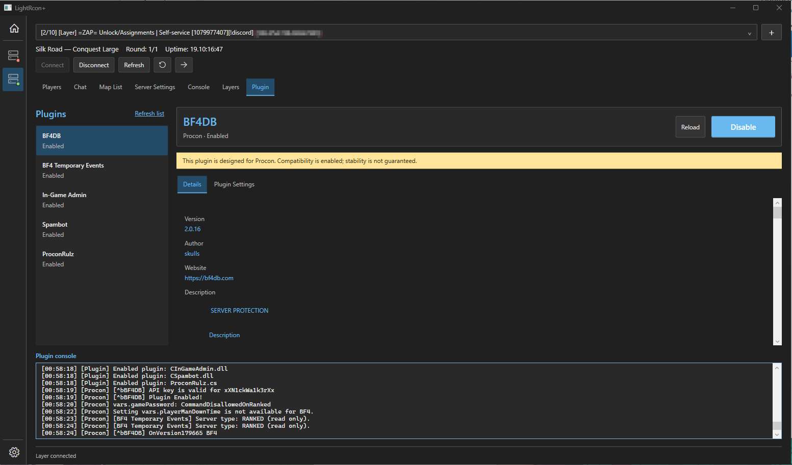

# Compatibility for PRoCon plugin
List of compatibity for PRoCon plugin. LightRcon+ has build-in compatibility layer is used to enable the use of standard PRoCon plugins.

>[!WARNING]
>For reference only; the results of this test may differ from the results you obtain in your own testing.

# BF4DB
### Score: 8/10 - Working

Link: https://bf4db.com/plugin
>[!IMPORTANT]
>BF4DB accepted [CC BY-ND 4.0](https://creativecommons.org/licenses/by-nd/4.0/), which is no one can distribute modified version. LightRcon+ will not modify BF4DB to LightRcon+ version.

| Features | Test on LightRcon+ |
| --- | --- |
| API Key | Working |
| Check player `!check` | Working, but with little issue |
| Auto kick/Ban | Not test yet |
| Whitelist | Not test yet |

# SpamBot
### Score: 10/10 - Perfect

| Features | Test on LightRcon+ |
| --- | --- |
| AutoSay | Working |
| Timing | Working |
| Lines of word | Working |

# In-Game Admin
### Score: 7/10 - Working

| Features | Test on LightRcon+ |
| --- | --- |
| Kill | Working |
| Nuke | Working |
| Kick | Working |
| Other | Not test yet |